<p align="center"><picture><source media="(prefers-color-scheme: dark)" srcset="docs/brand/readme-header-dark.png"></picture></p>

# Wallowa Weather

**Experimental.** Wallowa Weather is a free phone web app for Wallowa County, Oregon: the next 90 minutes of storms, worked
out on your own phone. It shows NOAA radar, satellite and lightning on a map of the county, and three experimental forecast
models that download once and run on the phone through WebGPU:

- **NVIDIA StormScope** (radar, satellite and lightning, 10-minute steps to 90 minutes), quantised to 8-bit for phones;
- **DeepMind DGMR** (rain from radar, to 90 minutes);
- **BEAM**, the Blended Early-warning Alert Model: hail, lightning, cloudbursts and strong storm cores for the next
  0-30, 30-60 and 60-90 minutes, made for places the radar does not see well.

National Weather Service warnings are always shown first, in their own outlines.

> **Not an NWS warning.** Every forecast in this app is experimental and can be wrong. For warnings, follow the US
> National Weather Service (weather.gov) and your local emergency officials.

## Use it

Open **https://wallowaweather.github.io/** in Chrome on an Android phone, then use the browser menu's **Install app** (or **Add to Home
screen**). On an iPhone, open it in Safari and use **Share > Add to Home Screen**. The menu inside the app has a step-by-step
install guide. The map, radar and NWS warnings work at once; each forecast model is a one-time download (in Settings).

## Screenshots

> **Experimental - not an official warning.** The storm pictures are the app's recorded example storms (real past storms
> played back, not a forecast for today and not a measure of accuracy). The other map pictures are live data as it was around
> 1 PM on a November day (NOAA radar, NOAA HRRR forecasts for 4 PM, GOES satellite imagery): whatever the weather was then.
> Every picture was made with the browser's graphics acceleration off, so the map's colour fields are drawn the app's simpler
> way and look a little blockier than on most phones. Tap a picture for the full size.

<table>
<tr>
<td align="center" width="33%"><a href="docs/screenshots/landing-iphone.png">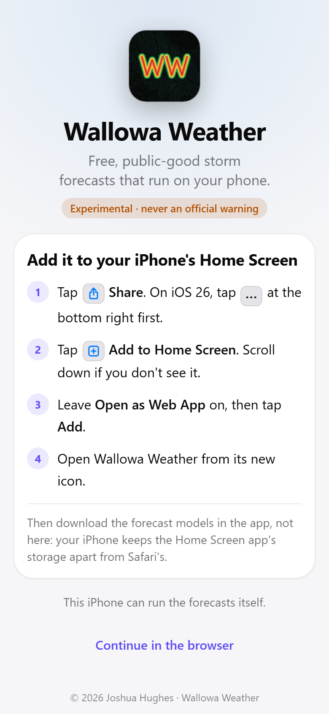</a><br><sub>First run on an iPhone</sub></td>
<td align="center" width="33%"><a href="docs/screenshots/landing-android.png">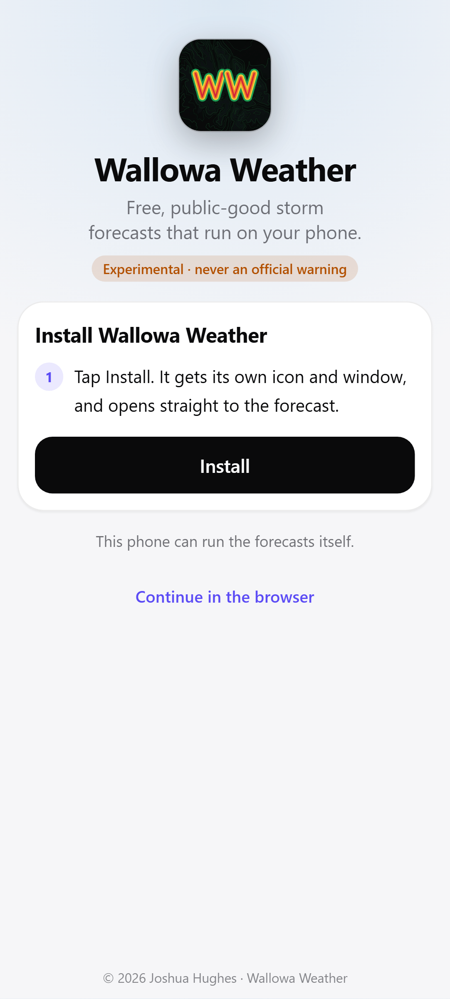</a><br><sub>First run on Android</sub></td>
<td align="center" width="33%"><a href="docs/screenshots/download-all.png">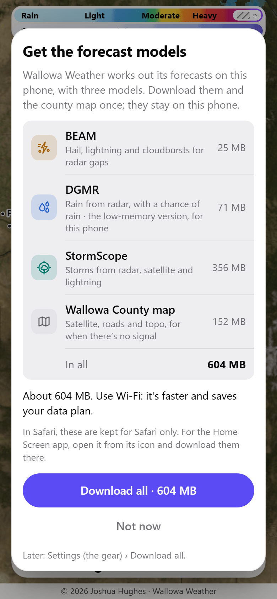</a><br><sub>Download all</sub></td>
</tr>
<tr>
<td align="center"><a href="docs/screenshots/map-wallowa-light.png">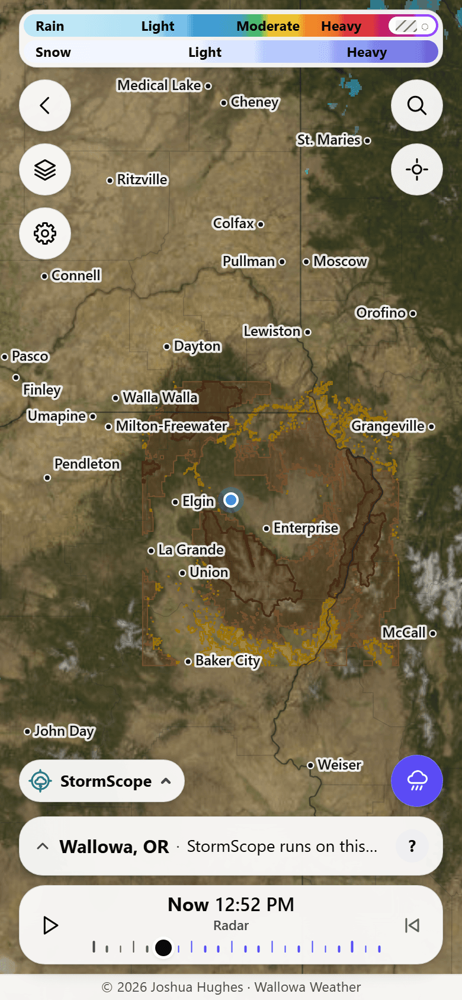</a><br><sub>The map at Wallowa (light)</sub></td>
<td align="center"><a href="docs/screenshots/map-wallowa-dark.png">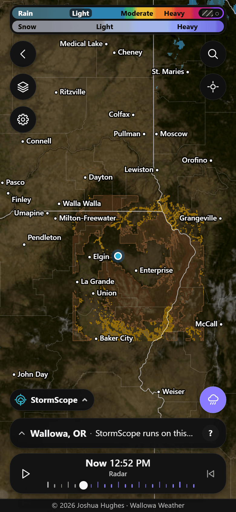</a><br><sub>The map at Wallowa (dark)</sub></td>
<td align="center"><a href="docs/screenshots/layers.png">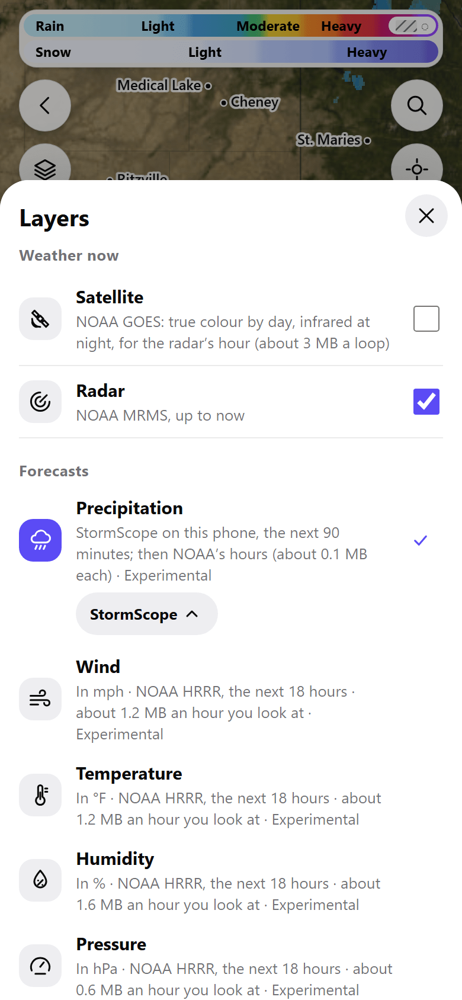</a><br><sub>Layers: Weather now and Forecasts</sub></td>
</tr>
<tr>
<td align="center"><a href="docs/screenshots/layers-presets.png">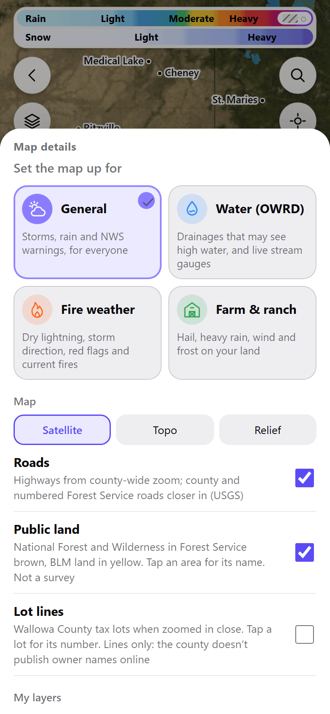</a><br><sub>Layers › Map details and presets</sub></td>
<td align="center"><a href="docs/screenshots/forecast-wind.png">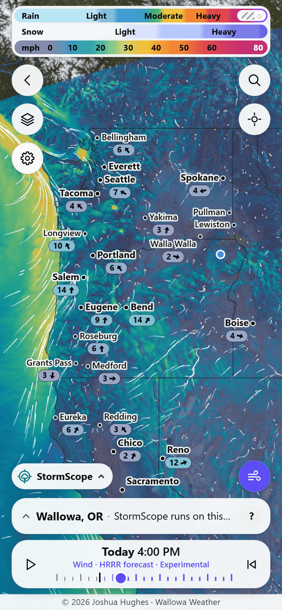</a><br><sub>Wind forecast (NOAA HRRR)</sub></td>
<td align="center"><a href="docs/screenshots/forecast-temperature.png">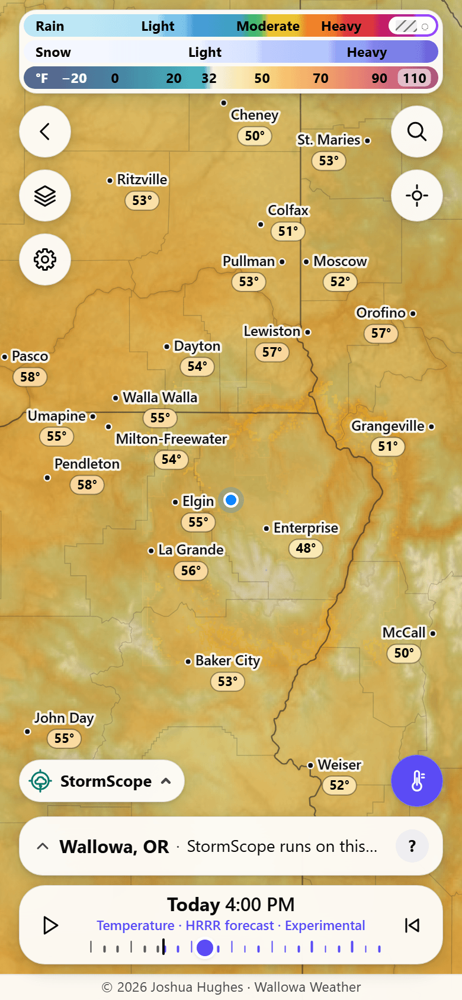</a><br><sub>Temperature forecast, with values under the names</sub></td>
</tr>
<tr>
<td align="center"><a href="docs/screenshots/forecast-pressure.png">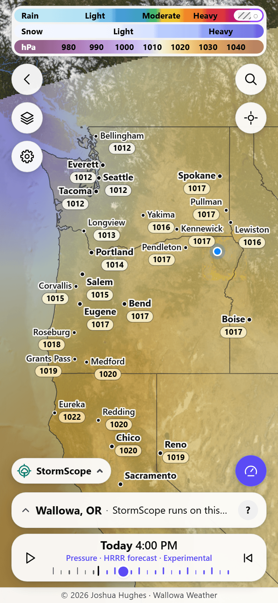</a><br><sub>Pressure forecast (NOAA HRRR)</sub></td>
<td align="center"><a href="docs/screenshots/satellite.png">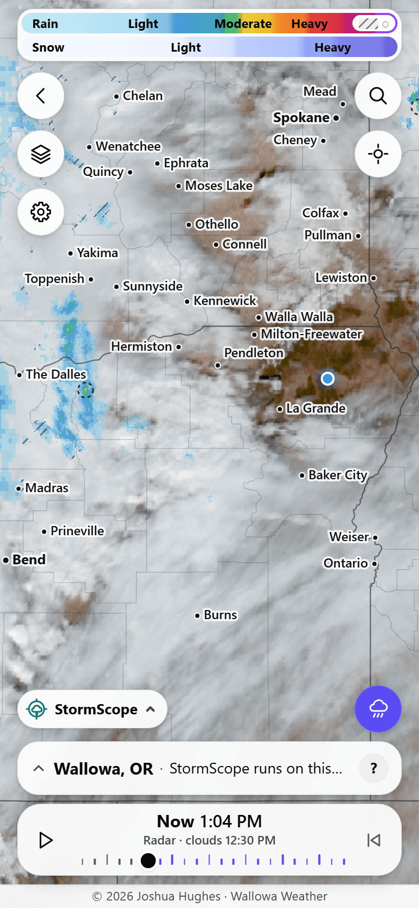</a><br><sub>Satellite (NOAA GOES)</sub></td>
<td align="center"><a href="docs/screenshots/beam-hail-2022-08-11-light.png">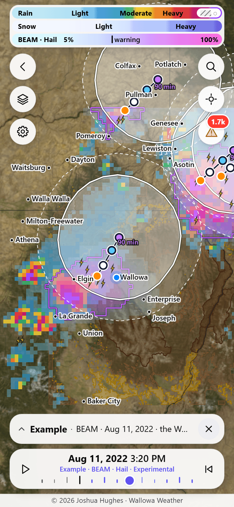</a><br><sub>BEAM: the Aug 11, 2022 hailstorm, cone and hail warning outline</sub></td>
</tr>
<tr>
<td align="center"><a href="docs/screenshots/beam-hail-2022-08-11-dark.png">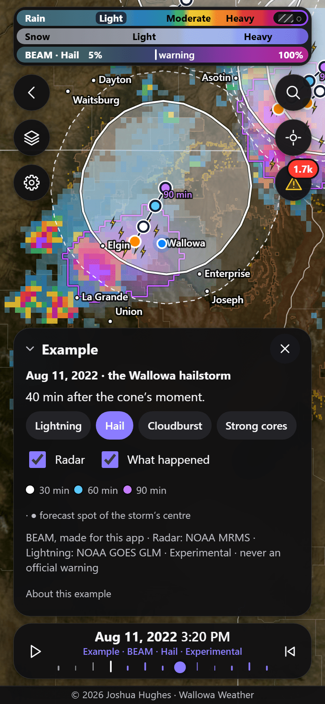</a><br><sub>BEAM example storm (dark, card unfolded)</sub></td>
<td align="center"><a href="docs/screenshots/dgmr-example-2022-08-11.png">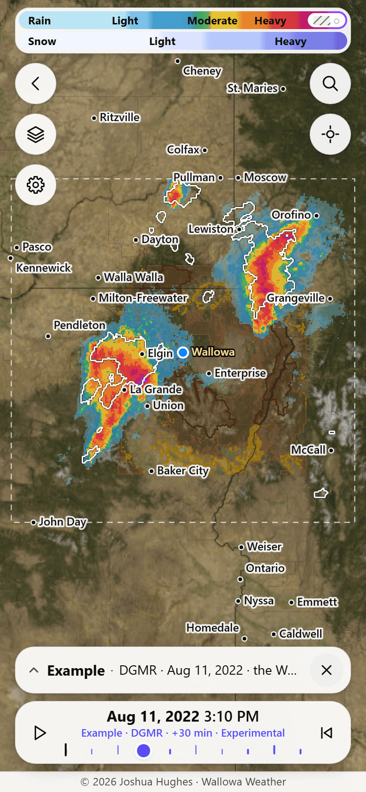</a><br><sub>DGMR: forecast vs. what happened (outline)</sub></td>
<td align="center"><a href="docs/screenshots/stormscope-example-2025-07-31.png">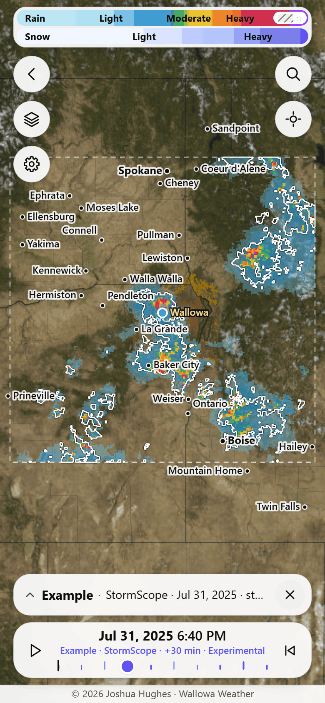</a><br><sub>StormScope: the Jul 31, 2025 storm</sub></td>
</tr>
<tr>
<td align="center"><a href="docs/screenshots/settings.png">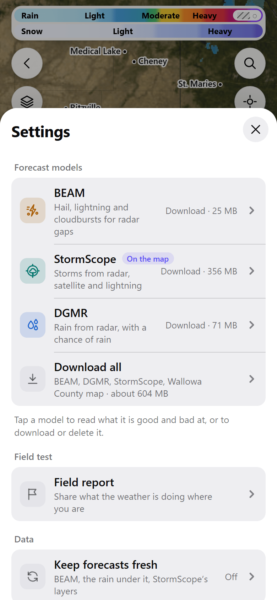</a><br><sub>Settings</sub></td>
<td align="center"><a href="docs/screenshots/settings-counties.png">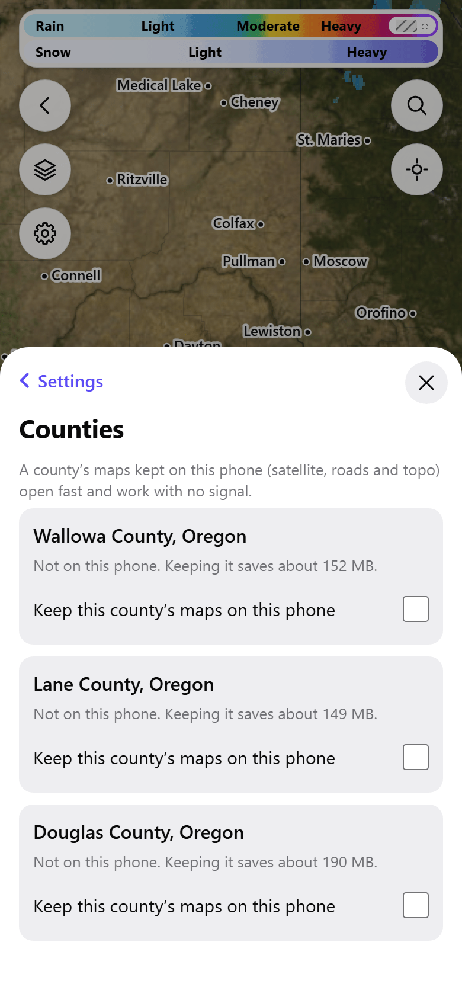</a><br><sub>Settings › Counties (a new phone)</sub></td>
<td align="center"><a href="docs/screenshots/lot-lines-roseburg.png">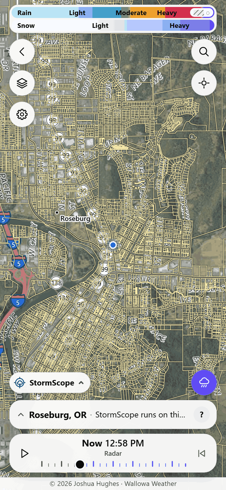</a><br><sub>Lot lines: Douglas County, Roseburg</sub></td>
</tr>
<tr>
<td align="center"><a href="docs/screenshots/field-report.png">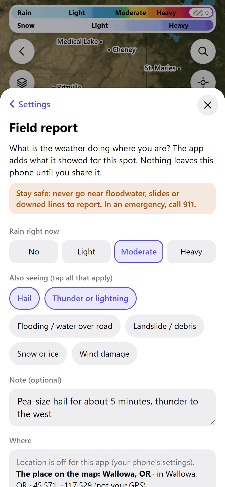</a><br><sub>Field report (an example)</sub></td>
<td align="center"><a href="docs/screenshots/install-android.png">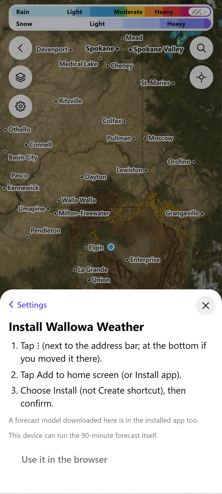</a><br><sub>Install guide (Android)</sub></td>
<td align="center"><a href="docs/screenshots/speed-tune.png">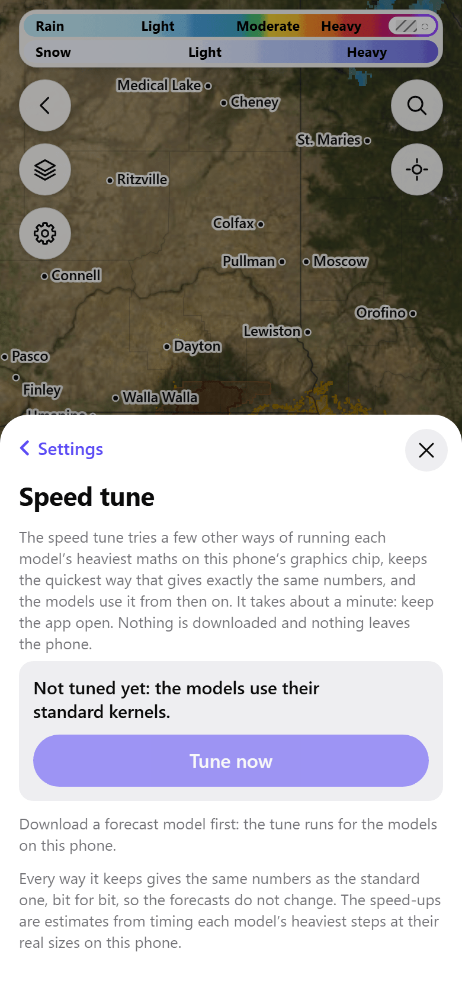</a><br><sub>Settings › Speed tune</sub></td>
</tr>
<tr>
<td align="center"><a href="docs/screenshots/bench-page.png">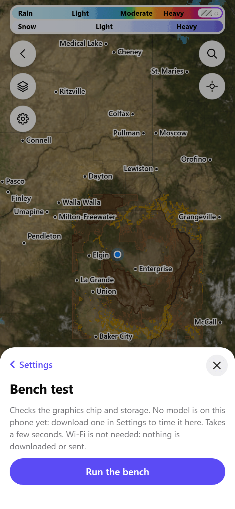</a><br><sub>Settings › Bench test (before a run)</sub></td>
<td></td>
<td></td>
</tr>
</table>

## Privacy

No account, no tracking, no analytics, no cookies.

**What leaves your phone.** Like any website, each service the app asks sees your internet address. GitHub Pages serves the app
itself. The place on the map, rounded to about 1 km, goes to the National Weather Service for its forecast and alerts. Map tiles and
lot lines for the area on screen come from USGS, NASA, Oregon Explorer and the county's map service (Wallowa County's is hosted by Esri
ArcGIS). Radar, satellite and forecast data come from NOAA's open data on Amazon Web Services, in whole files or pieces about 200 km
across or more, never for one spot. River gauges (USGS) and fires (NIFC, on ArcGIS) come for the whole county. Each time it opens, the
app checks its model files at Hugging Face.

**Your location.** The app never sends or saves your exact GPS position. When you tap Locate, or the app opens on your location, that
place is used like any place you pick: the Weather Service gets it rounded to about 1 km, and the map loads the tiles around it.
Otherwise it leaves the phone only in a field report or a location you share, and you see what is shared first.

**Kept on your phone.** Your settings and last place, your last 3 nowcasts, recent forecast-map hours, the county maps you keep (with
the tiles you looked at), My layers and your field reports. Nothing is uploaded. Clearing this site's data in your browser removes it
all.

## Credits and licences

The app's map data and forecasts come from public sources (NOAA, the National Weather Service, NASA GIBS, USGS / USDA, the
BLM, the US Forest Service, the US Census Bureau, the Oregon Statewide Imagery Program and Wallowa County). None of them
endorses this app. Every credit and licence is listed inside the app under **Licenses and credits** (behind the **?** on the
forecast card, and in Menu > About), and in [`licenses/`](licenses/):

- NVIDIA StormScope: NVIDIA Open Model License ([`licenses/NVIDIA-Open-Model-License.txt`](licenses/NVIDIA-Open-Model-License.txt),
  [`licenses/NOTICE.txt`](licenses/NOTICE.txt)). Licensed by NVIDIA Corporation under the NVIDIA Open Model License. This app is
  not affiliated with or endorsed by NVIDIA.
- DeepMind DGMR: CC BY 4.0, Copyright 2021 DeepMind Technologies Limited.
- Code derived from NVIDIA Earth2Studio: Apache License 2.0 ([`licenses/Apache-2.0.txt`](licenses/Apache-2.0.txt)).
- Solar-angle code from climt (via NVIDIA PhysicsNeMo): BSD 3-clause ([`licenses/BSD-3-Clause-climt.txt`](licenses/BSD-3-Clause-climt.txt)).

The model files are downloaded from Hugging Face, each with its licence and notice beside it.

## Run it locally

No build step and no dependencies: the app is plain ES modules.

```
python3 tools/serve.py                          # http://127.0.0.1:8080/ (at the root, as GitHub Pages serves it)
python3 tools/serve.py --base /sub/path/          # http://127.0.0.1:8080/sub/path/ (to try it under a sub-path)
```

WebGPU, the service worker and the browser's private storage need a secure context (`https://`, or `http://127.0.0.1`), so
open the address the server prints. Before each deploy the Pages workflow runs `python3 tools/check_packs.py` (every model
pack on a pinned Hugging Face revision), `python3 tools/check_sw.py` (the offline list in `sw.js` matches the files that ship;
`--write` refills it) and `python3 tools/scan_secrets.py` (nothing private ships); any failure stops the deploy.

## Logo

The WW logo by Josh Hughes: two Ws drawn as radar echoes over a top-down contour map of the Wallowa Mountains (elevation: USGS 3DEP, public domain), rendered from the vector design (`docs/brand/logo-vector.svg`) with FLUX.2 [klein] 4B (Black Forest Labs, Apache License 2.0). Copyright (c) 2026 Joshua Hughes; covered by the app's licence.

## Licence

Copyright (c) 2026 Joshua Hughes. The app is **source-available, non-commercial software** under the
[Wallowa Weather Non-Commercial License 1.0](LICENSE.md): you may read it, run it for yourself and improve it; you may not
sell it, and serving it to other people needs Josh Hughes's express written permission (licences are available on request
and granted case by case after review).

**BEAM**, the Blended Early-warning Alert Model created by artist Josh Hughes, is released separately under the
[Apache License 2.0](licenses/Apache-2.0.txt) with its [NOTICE](licenses/BEAM-NOTICE.txt). The third-party models, code
and data keep their own licences, listed above.
